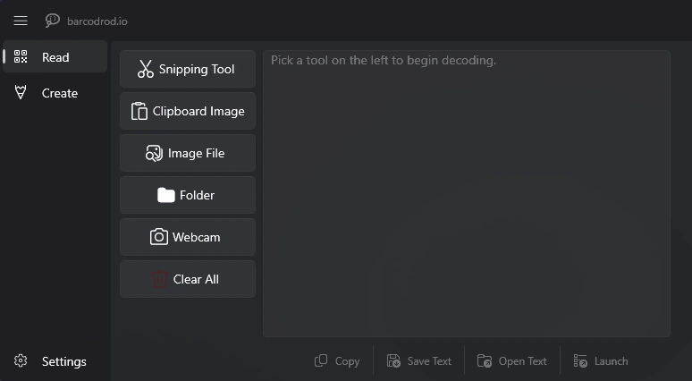

<h1>Desktop QR Code Scanner for PC</h1>

A free, portable Windows app that reads QR codes and barcodes from your screen, images and webcam. No phone needed.

<a href="https://sourceforge.net/projects/qr-code-scanner-pc/files/latest/download"><b>Download from SourceForge</b></a>
&nbsp;&nbsp;|&nbsp;&nbsp;
<a href="https://sourceforge.net/projects/qr-code-scanner-pc/"><b>SourceForge project page</b></a>
&nbsp;&nbsp;|&nbsp;&nbsp;
<a href="https://swiftorcaplug.github.io/desktop-qr-code-scanner/">Website</a>

## About this QR scanner for PC

This is desktop software for reading QR codes on a Windows computer, not a USB hardware scanner. It works on a desktop PC or a laptop, with or without a camera, because most codes you meet on a computer are already on the screen or in a file.

It runs locally, so your images and decoded data stay on your PC. It also works as a barcode reader and a QR code generator.

## Download from SourceForge

The app is distributed through its [SourceForge project page](https://sourceforge.net/projects/qr-code-scanner-pc/).

1. [Download the ZIP from SourceForge](https://sourceforge.net/projects/qr-code-scanner-pc/files/latest/download).
2. Extract it to any folder.
3. Run the app. There is nothing to install.

**Requirements:** Windows 10 or Windows 11, 64-bit. A webcam is optional and only needed for camera scanning.

## How to scan a QR code on your PC

Open the **Read** screen and pick the source that matches where your code is:

| Where the code is | Button | Good for |
| --- | --- | --- |
| On your screen | **Snipping Tool** | Codes in a browser, an email or a document |
| Copied to the clipboard | **Clipboard Image** | Screenshots and pictures copied from a web page |
| In a saved picture | **Image File** | Tickets, posters and photos someone sent you |
| In many pictures | **Folder** | Decoding every image in a folder at once |
| In front of a camera | **Webcam** | Printed codes, packaging and other devices |

The result appears next to the buttons. Check it first, then use **Copy** to keep it or **Launch** to open it.

Step-by-step guides:

- [How to scan a QR code from an image on PC](https://swiftorcaplug.github.io/desktop-qr-code-scanner/scan-qr-code-from-image/)
- [How to scan a QR code on a PC or laptop](https://swiftorcaplug.github.io/desktop-qr-code-scanner/scan-qr-code-on-pc/)

## Features

- **Screen capture:** scan a QR code on your computer screen with the Windows Snipping Tool.
- **Image reader:** read a QR code from an image file, a screenshot or a copied picture.
- **Camera support:** use a laptop camera, a webcam, an OBS virtual camera or the Windows Camera app.
- **Bulk scanning:** decode a whole folder of images at once.
- **Barcode reader:** read 17 barcode types on your PC.
- **QR code generator:** create codes from text, with templates for Wi-Fi, email and contact cards.
- **Custom output:** change colors, margins and the error correction level.
- **History:** view and export the codes you read and created, or turn history off.
- **Themes:** light and dark.

## Supported barcode types

| Support | Formats |
| --- | --- |
| Read and create | QR Code, Code 128, Code 39, EAN-8, ITF, UPC-A, UPC-E, Codabar, Data Matrix, PDF417, Aztec, MSI, Plessey |
| Read only | MaxiCode, RSS-14, RSS Expanded, EAN-13 |

## Privacy

- Codes are read and created locally, and no network connection is needed to do it.
- Decoded and generated data is not collected.
- You can inspect the contents of a QR code before opening a link.
- Generated codes contain exactly what you enter, with no redirect link added.

## FAQ

### Is this QR code scanner free?

Yes. It is freeware with no paid version, and the source code is available under the Apache 2.0 license.

### Do I need a phone or a webcam?

No. You can read codes from your screen, an image file or the clipboard without any camera.

### Can it scan a QR code from an image?

Yes. Click **Image File** for a saved picture, or **Clipboard Image** for a screenshot or a copied picture.

### Does it work offline?

Yes. Reading and creating codes happen on your PC, without a network connection.

### Is it a QR code scanner for laptops too?

Yes. It runs on any Windows 10 or 11 64-bit laptop or desktop and can use the built-in laptop camera.

### Does it work on Mac or Linux?

No. It is a Windows app.

## Build from source

The app is built with WinUI 3, the Windows App SDK, .NET 9 and [ZXing.Net](https://github.com/micjahn/ZXing.Net). To build it yourself, clone this repository and open `barcodrod.io.sln` in Visual Studio.

## License

Released under the [Apache License 2.0](LICENSE.txt).
